# Arquitectura y Diseño de Sistemas de Detección y Prevención de Intrusos (IDS / IPS)

Este documento detalla la fundamentación conceptual, el análisis comparativo de herramientas Open Source, la propuesta arquitectónica y la implementación técnica de la solución **IDS / IPS** desplegada en la infraestructura corporativa de la organización (`SUDOERS.LAN`).

---

## 1. Fundamentos Conceptuales: IDS vs IPS

### 1.1 Sistema de Detección de Intrusos (IDS - Intrusion Detection System)
Un **IDS** es un dispositivo o aplicación de seguridad que supervisa de forma **pasiva** el tráfico de la red o las actividades de un sistema en busca de comportamientos maliciosos, violaciones de políticas de seguridad o anomalías operativas.

* **Modo de Operación:** Opera fuera de la ruta directa del tráfico (*out-of-band*). Recibe una copia de los paquetes mediante un puerto espejo (*SPAN / Port Mirroring*) en un conmutador de red, un TAP físico de red o un socket en modo promiscuo (`AF_PACKET` en Linux).
* **Mecanismo de Respuesta:** Genera alertas, registros en bitácoras (*syslog / JSON*) o notificaciones a consolas de monitoreo (SIEM / Zabbix). **No altera ni detiene el flujo de los paquetes evaluados.**
* **Ventajas:**
  * Cero impacto en la latencia de la red de producción.
  * Inmunidad contra caídas: si el sensor falla o se satura, el tráfico de los usuarios y servidores no se interrumpe.
  * Bajo riesgo operativo: un falso positivo solo produce una alerta redundante, no una denegación de servicio.
* **Limitaciones:**
  * Naturaleza puramente reactiva: el ataque llega a la víctima antes o al mismo tiempo que se genera la alerta.

---

### 1.2 Sistema de Prevención de Intrusos (IPS - Intrusion Prevention System)
Un **IPS** es una evolución activa del IDS que se sitúa **en línea** (*in-line*) en la ruta crítica por donde transita la información, con la capacidad de analizar cada paquete antes de permitirle continuar hacia su destino.

* **Modo de Operación:** El tráfico atraviesa obligatoriamente el motor de inspección. En Linux, esto se logra vinculando el subsistema de filtrado del kernel (`nftables` o `iptables`) con el espacio de usuario mediante colas de red (**NFQUEUE**).
* **Mecanismo de Respuesta:** Además de generar alertas, el IPS puede **descartar paquetes maliciosos en tiempo real (`drop`)**, reiniciar conexiones TCP anómalas (`reject` / RST) o bloquear dinámicamente direcciones IP de origen hostiles.
* **Ventajas:**
  * Protección proactiva y preventiva: los exploits y cargas maliciosas son neutralizados antes de alcanzar los servicios vulnerables.
  * Automatización de la defensa sin necesidad de intervención manual inmediata de los analistas de seguridad.
* **Riesgos y Consideraciones Operativas:**
  * **Falsos Positivos:** Si una regla clasifica erróneamente tráfico empresarial legítimo como malicioso con acción `drop`, se provoca una denegación de servicio autoinfligida.
  * **Latencia y Punto Único de Falla:** Cada paquete debe ser evaluado, lo que exige procesadores de alta velocidad y mecanismos de alta disponibilidad (como la directiva `bypass` en `nftables` de Linux, que permite que el tráfico continúe si el motor IPS se detiene).

---

### 1.3 Cuadro Resumen Comparativo

| Característica | IDS (Detección de Intrusos) | IPS (Prevención de Intrusos) |
|---|---|---|
| **Posicionamiento en Red** | Pasivo / Fuera de banda (Copia / SPAN) | Activo / En línea (In-line / NFQUEUE) |
| **Acción ante Amenazas** | Registro y emisión de alertas | Bloqueo, descarte de paquetes y alertas |
| **Impacto en Latencia** | Nulo (0 ms adicionales) | Ligero incremento por inspección en tránsito |
| **Riesgo por Falsos Positivos** | Bajo (Ruido en registros) | Alto (Bloqueo de tráfico operativo) |
| **Comportamiento en Falla** | Indiferente para la red | Requiere *Fail-Open / Bypass* para evitar corte |

---

## 2. Análisis Comparativo de Herramientas Open Source

Para la defensa de esta infraestructura se evaluaron técnicamente las dos soluciones líderes en el ecosistema de código abierto: **Suricata** y **Snort 3**.

```mermaid
graph TD
    subgraph "Suricata (dc1 - Nativo)"
        S_NIC[Interfaz Física] --> S_AF[AF_PACKET / NFQ]
        S_AF --> S_MT[Multi-threading Real]
        S_MT --> S_HS[Motor Hyperscan]
        S_HS --> S_DEC[Decodificador: Kerberos/SMB/DNS/HTTP]
        S_DEC --> S_EVE[EVE.JSON + fast.log]
    end

    subgraph "Snort 3 (Referencia/Lab)"
        N_NIC[Interfaz de Red] --> N_DAQ[DAQ Layer]
        N_DAQ --> N_TH[Packet Processing Threads]
        N_TH --> N_LUA[Configuracion Lua]
        N_LUA --> N_OUT[alert_fast / alert_json]
    end
```



### 2.1 Comparativa Técnica Profunda

| Parámetro Técnico | Suricata (Implementada en `dc1`) | Snort 3 (Cisco Talos) |
|---|---|---|
| **Modelo de Hilos (Threading)** | **Multi-threading nativo y simétrico.** Los hilos se distribuyen de forma autónoma entre todos los núcleos de CPU del host asignando flujos de red completos (*flow pinning*). | **Multi-threaded modular (Snort 3).** Superó la arquitectura monohilo de Snort 2; utiliza hilos independientes coordinados mediante la capa DAQ. |
| **Motor de Patrones** | Soporte integral de **Intel Hyperscan** con aceleración por hardware (AVX2/AVX-512), permitiendo evaluar decenas de miles de firmas a velocidad de cable. | Soporte de Hyperscan y algoritmos Aho-Corasick mediante configuración en Lua. |
| **Mecanismo IPS en Linux** | Integración transparente con **`nftables`** a través de **NFQUEUE**. Permite alternar reglas `alert` y `drop` de forma nativa. | Utiliza el módulo DAQ `daq_nfq` para interactuar con colas Netfilter de Linux. |
| **Inspección de Protocolos** | Decodificación profunda de protocolos empresariales clave: **Kerberos (88), SMB (445), DCERPC, LDAP, DNS, TLS y HTTP/2**. | Fuerte en HTTP/TCP/UDP. Decodificación SMB avanzada mediante nuevos inspectores de Snort 3. |
| **Formato de Auditoría y Logs** | Formato unificado **EVE JSON** (`eve.json`) que incluye flujos, alertas, metadatos TLS/DNS y eventos de descarte `drop`. | Formato JSON en Snort 3 y logs tradicionales en formato de texto o binario unificado. |
| **Facilidad de Despliegue en Debian** | **Excelente.** Paquete oficial en Debian 12/13 con soporte para `suricata-update` y systemd nativo. | **Moderada a Compleja.** No empaquetado oficialmente en Debian 12/13 base; requiere compilación desde fuentes o contenedor Docker. |

### 2.2 Justificación de la Elección de Suricata
Se seleccionó **Suricata** como motor nativo para el servidor `dc1` debido a:
1. **Sintonía con el entorno Active Directory:** dc1 actúa como Controlador de Dominio Samba 4. La capacidad de Suricata para decodificar nativamente SMB, Kerberos y LDAP permite inspeccionar intentos de explotación interna (como Kerberoasting o ataques a shares).
2. **Alta resiliencia con `nftables`:** La directiva `bypass` en las colas NFQUEUE de `nftables` garantiza que el firewall mantenga la disponibilidad total del servidor aún si el proceso de Suricata es reiniciado.

---

## 3. Propuesta Arquitectónica en la Red Empresarial

### 3.1 Dónde Ubicar el Monitor en una Red Empresarial

En una arquitectura de ciberseguridad corporativa existen tres ubicaciones estratégicas para sensores IDS/IPS:

1. **Perímetro Externo (IPS en Línea tras el Firewall de Borde):**
   * *Objetivo:* Mitigar tráfico malicioso proveniente de Internet (fuerza bruta, escaneos masivos, ataques DoS y exploits a servicios publicados).
   * *Tipo:* In-line IPS.
2. **Distribución / Core Interno (IDS Pasivo en Switch de Distribución):**
   * *Objetivo:* Visibilidad de tráfico Este-Oeste (movimientos laterales entre departamentos, infección por malware entre clientes y escaneos de red internos).
   * *Tipo:* SPAN / Mirror Port IDS.
3. **Servidor Crítico / Host-based Network IPS (H-NIPS en dc1):**
   * *Objetivo:* Inspección directa en el host que concentra los servicios centrales de identidad, correo, archivos y DNS, protegiendo las aplicaciones antes del procesamiento en espacio de usuario.
   * *Tipo:* In-line IPS mediante NFQUEUE.

### 3.2 Diagrama Lógico de la Infraestructura (`192.168.0.0/24`)

```mermaid
graph TD
    WAN((Internet / Red Externa)) -->|WAN| ROUTER[Router TP-Link TL-WR850N\n192.168.0.1]
    
    subgraph "LAN Corporativa 192.168.0.0/24"
        ROUTER -->|Cable Ethernet| DC1_HOST["Servidor Central: dc1 (192.168.0.2)"]
        ROUTER -.->|WiFi 802.1X / LAN| CLIENTS["Clientes y Admins (.50 - .199)"]
        ROUTER -->|LAN| ZABBIX_HOST["Servidor Monitoreo: zabbix (192.168.0.3)"]
        
        subgraph "Arquitectura Interna de dc1"
            DC1_HOST --> NIC[Interfaz de Red eno1 / fisica]
            
            NIC --> NFT[Firewall nftables\ninet filter input]
            
            NFT -->|Hook: queue num 0 bypass| SURI{Suricata 7\nMotor IDS / IPS}
            
            SURI -->|Veredicto: ACCEPT\n+ Alerta si coincide| LOGS[(Logs: fast.log & eve.json)]
            SURI -->|Veredicto: DROP\n(Ataque Bloqueado)| DROP_SINK[Descarte en Kernel\nPaquete Eliminado]
            
            NFT -->|Trafico Permitido| SVCS[Servicios Corporativos\nAD Samba, DNS, SMB, Nginx Web, Mail]
        end
    end
```

---

## 4. Guía de Operación y Verificación de Laboratorio

La solución cuenta con un conjunto de herramientas y scripts ubicados en [`server/suricata/`](file:///home/joaquin/repos/linux-homelab-enterprise/server/suricata/):

### 4.1 Puesta en Marcha Inicial
Para desplegar la configuración completa de Suricata en el servidor `dc1`:
```bash
sudo bash server/suricata/setup.sh
```

### 4.2 Alternar entre Modos Operativos
```bash
# Activar prevención y descarte activo en tiempo real:
sudo bash server/suricata/ips-toggle.sh --ips

# Retornar a modo pasivo (solo auditoría y alertas):
sudo bash server/suricata/ips-toggle.sh --ids

# Comprobar el modo operativo y ver las alertas más recientes:
bash server/suricata/ips-toggle.sh --status
```

### 4.3 Ejecutar Batería de Pruebas Automatizadas
El script de prueba valida tanto el comportamiento de detección como el de prevención:
```bash
sudo bash server/suricata/test-ids-ips.sh
```

* **Resultado esperado en Modo IDS:** La sonda de prueba genera una alerta `[HOMELAB-IDS-ALERT]` en `/var/log/suricata/fast.log` y la conexión es completada con éxito.
* **Resultado esperado en Modo IPS:** La carga maliciosa simulada `MALICIOUS_SIMULATION_ATTACK` genera un registro `[HOMELAB-IPS-DROP]` y la conexión TCP es abortada y descartada por el kernel antes de ser atendida por el servidor web o el servicio protegido.
